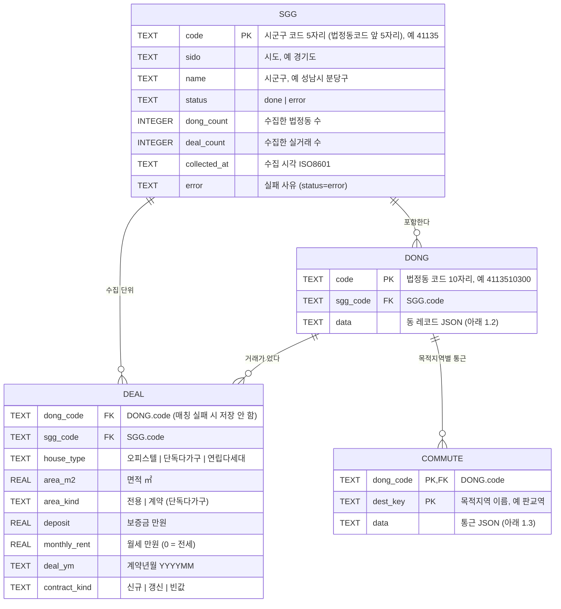
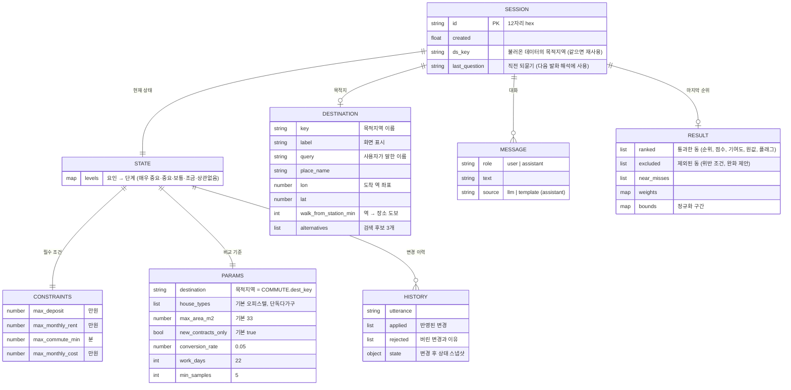

# ERD (데이터 모델)

저장소는 두 가지다.

| 구분 | 위치 | 수명 | 내용 |
|---|---|---|---|
| **영속 저장소** | SQLite `data/store.sqlite` (`backend/store.py`) | 서버를 다시 켜도 남음 | 수집한 시군구·법정동·실거래·통근 |
| **세션 메모리** | 서버 프로세스 메모리 (`backend/agent.py: Session`) | 서버를 다시 켜면 사라짐 | 대화 상태(단계·필수 조건·목적지), 메시지, 마지막 결과 |

외부 API 응답 캐시(`data/cache/<출처>/<해시>.json|xml`)는 파일 저장소로, 모델에는 포함하지 않는다.

## 1. 영속 저장소 (SQLite)

| 테이블 | 키·인덱스 | 쓰기 시점 | 규모 (판교역 주변 13개 시군구 기준) |
|---|---|---|---|
| `sgg` | PK `code` | 시군구 수집 완료·실패 시 | 13행 |
| `dong` | PK `code`, 인덱스 `sgg_code` | 시군구 수집 완료 시 (시군구 단위로 지우고 다시 넣음) | 302행 |
| `deal` | 인덱스 `dong_code` | 시군구 수집 완료 시 | 132,076행 |
| `commute` | PK (`dong_code`, `dest_key`) | 새 목적지역의 후보 동 통근 계산 시 | 71행 (목적지 1곳) |

- `DESTINATION`(목적지역)은 테이블이 아니다. 통근의 `dest_key`(역 이름)로만 쓴다. 회사·동네 이름은 가장 가까운 역으로 바뀌어 같은 키를 공유한다
- 시군구 수집은 시군구 단위로 잠금을 걸어 같은 시군구를 두 번 수집하지 않는다

### 1.1 실거래 기간과 필터

- 기간: `settings.RENT_END_YM`(202610)에서 12개월. 마감 후 고정
- 저장은 전부(전세·갱신·큰 면적 포함), 필터는 엔진이 `Params` 로 한다

### 1.2 `DONG.data` JSON

| 필드 | 타입 | 예 | 설명 |
|---|---|---|---|
| `dong_code` | string | `4113510300` | = `DONG.code` |
| `sido`, `sgg`, `name` | string | 경기도, 성남시 분당구, 정자동 | |
| `lon`, `lat` | number | 127.11, 37.36 | 대표 지점 (생활 중심) |
| `point_source` | string | 생활 중심 (…) | 대표 지점을 정한 방법 |
| `area_km2_est` | number | 5.44 | 격자점 수 × 0.16㎢ |
| `station` | object \| null | `{name, lines[], dist_m, walk_min, lon, lat}` | 가장 가까운 지하철역. 3km 안에 없으면 null |
| `convenience` | object | `{"편의점": 21, "약국": 9, "대형마트": 6}` | 반경 안 개수 |
| `bars` | object | `{count, source}` | 반경 500m 주점 수와 출처 |

### 1.3 `COMMUTE.data` JSON

| 필드 | 타입 | 예 | 설명 |
|---|---|---|---|
| `min` | number | 15 | 대표 지점 → 목적지역 분 (역 → 회사 도보는 엔진에 넘길 때 더함) |
| `fare` | number \| null | 1550 | 편도 요금 원 |
| `transfers` | number | 0 | 환승 횟수 |
| `walk_min` | number | 4 | 경로 안 도보 분 |
| `mode` | string | 지하철 | 지하철 / 버스 / 버스+지하철 / 도보 |
| `lines` | string[] | [수인분당선] | 노선 |
| `map_url` | string | https://map.kakao.com/… | 카카오맵 경로 링크 |
| `error` | string | NO_RESULTS | 경로가 없을 때만 |

## 2. 세션 메모리 (대화 상태)

## 3. 엔진 입력 (메모리 객체)

| 객체 | 정의 | 만드는 곳 |
|---|---|---|
| `Dataset` | `dongs`(동 레코드 + `commute: {목적지역: COMMUTE.data}`), `deals_by_dong`(동 코드 → `Deal[]`), `meta` | `backend/regions.py: build_dataset` (SQLite → 반경 안 동만) |
| `Deal` | `DEAL` 한 행 | 위와 같음 |
| `DongFeature` | 동별 요인 원값 + 상세 + 조건에 맞는 거래 비용 목록 | `engine/features.py: build_features` |
